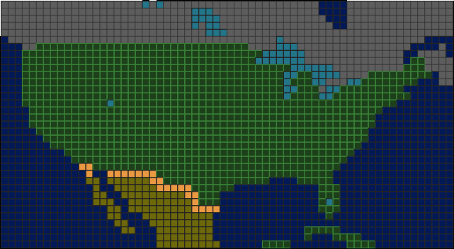

# Trans America

Drive across the post-apocalyptic United States.

[Play now on the browser](https://hatebit.github.io/transam/)

An attempt to remake [Tranz Am from the Commodore 64](https://en.wikipedia.org/wiki/Tranz_Am) in 3D.

## Controls

| Key           | Action                                    |
|---------------|-------------------------------------------|
| **W** / **S** | Accelerate / brake (and reverse)          |
| **A** / **D** | Steer left / right                        |
| **Space**     | Handbrake                                 |
| **R**         | Reset car to the start position           |
| **F**         | Nudge the car up (un-flip)                |
| **Arrow keys**| Move the camera                           |
| **I**         | Toggle the Babylon.js Inspector           |
| **O**         | Run the scene optimizer                   |
| **C**         | Clear the on-screen message log           |

## Map

## Technical details

* TypeScript - Language
* Babylon.js - 3D engine
* Havok - Physics engine (`@babylonjs/havok`)
* Vite - Build tool and dev server

## Credits

- [Tranz Am](https://en.wikipedia.org/wiki/Tranz_Am) - Original game
- [Kenney](https://kenney.nl/) - Assets
- [ManyTextures](https://manytextures.com/) - Textures